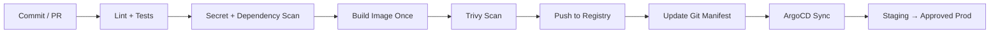

<!-- HEADER (same simple banner style as your original README, plus real text so the name always shows) -->

  
  <h1>Malka Manuranga</h1>
  <h3>Junior Cloud &amp; DevOps Engineer</h3>

<!-- TYPING ANIMATION -->

  

  
  

  
  
  
  
  

---

## 👋 About me

I'm a **BSc (Hons) Software Engineering graduate** (NSBM Green University) who builds **DevOps and cloud projects in public**. I care about the boring-but-vital parts of delivery: automated checks, least-privilege security, reproducible infrastructure and clear documentation.

- 🔭 Building: GitOps, CI/CD and Infrastructure-as-Code platforms
- 🎓 Studying: **AWS Certified Solutions Architect – Associate** *(in progress)*
- 🧪 Honesty rule: every project below marks what is **verified**, **written** or **planned**
- 💼 Background: Full Stack Intern (React, PostgreSQL, MongoDB) and Industrial Trainee (Agile project coordination)
- 📫 Reach me: **bmmanuranga@gmail.com**

---

## 🛠️ Tech stack

   
  

<b>Full toolbox</b>

| Area | Tools |
|---|---|
| **Containers** | Docker (multi-stage, non-root, healthchecks), Compose, Docker Hub, GHCR |
| **Orchestration & GitOps** | Kubernetes, kind, Kustomize, Helm, ArgoCD, Kyverno, kubeconform |
| **IaC** | Terraform (modules, envs, validation), Ansible, AWS (VPC, SG, S3) |
| **CI/CD** | GitHub Actions (matrix, caching, least-privilege), Jenkins, Dependabot |
| **Security** | Trivy, npm audit, SSH hardening, fail2ban, encrypted S3, read-only root FS |
| **Observability** | Prometheus, PromQL, Alertmanager, Grafana, promtool tests |
| **Languages** | Python, JavaScript/Node.js, HCL, Bash, PowerShell, YAML |

---

## 🚀 Featured projects

| Project | What it shows | Status |
|---|---|---|
| **[gitops-platform](https://github.com)** | Kustomize overlays (dev/staging/prod), ArgoCD apps, 9 Kyverno policies, kubeconform in CI |    |
| **[shortlink-platform](https://github.com)** | Containerised API: tests, Trivy, GHCR publish, Helm chart, Jenkins approval gate |   |
| **[platform-infra](https://github.com)** | Reusable Terraform modules (VPC, SG, encrypted S3) and Ansible hardening roles |   |
| **[observability-stack](https://github.com)** | Prometheus, Alertmanager, Grafana with alerts as code and promtool unit tests |   |
| **[cloudpulse-platform](https://github.com)** | Node.js metrics API, image-size comparison (single vs multi-stage), CI |   |
| **[orders-platform](https://github.com)** | Docker, Compose, Jenkins, Kubernetes end to end |  |
| **[status-api](https://github.com)** | FastAPI, pytest, ruff, CI matrix on Python 3.11/3.12 |  |

🟢 verified = ran or passed CI &nbsp;·&nbsp; 🟠 written/in progress = code exists, not yet proven live &nbsp;·&nbsp; 🔵 planned

---

## 🔄 How I like to ship

---

## 📊 GitHub stats

  
  

  

  

---

## 🎯 Currently working on

- ✅ Connecting repos into one flow: build → scan → publish → GitOps deploy
- 🔐 Adding image signing (cosign) and policy enforcement (Kyverno in a real cluster)
- ☁️ A safe, budget-capped `terraform apply` to AWS to turn "written" into "verified"
- 📚 AWS Solutions Architect – Associate study

  

